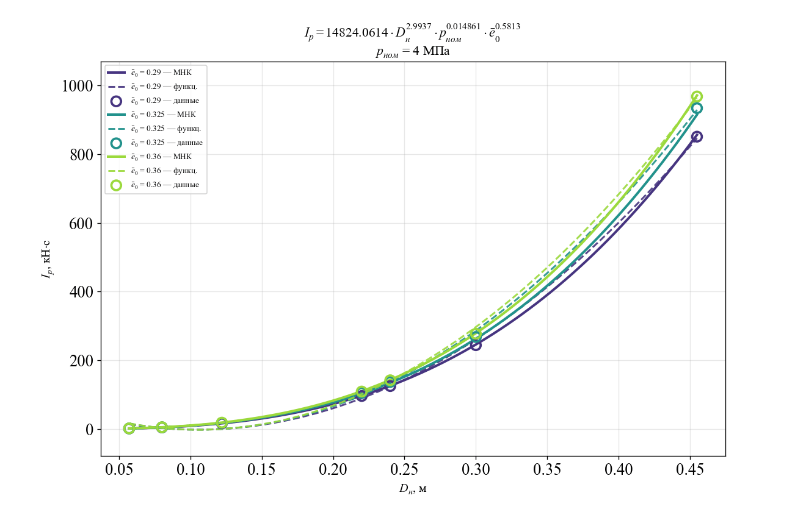
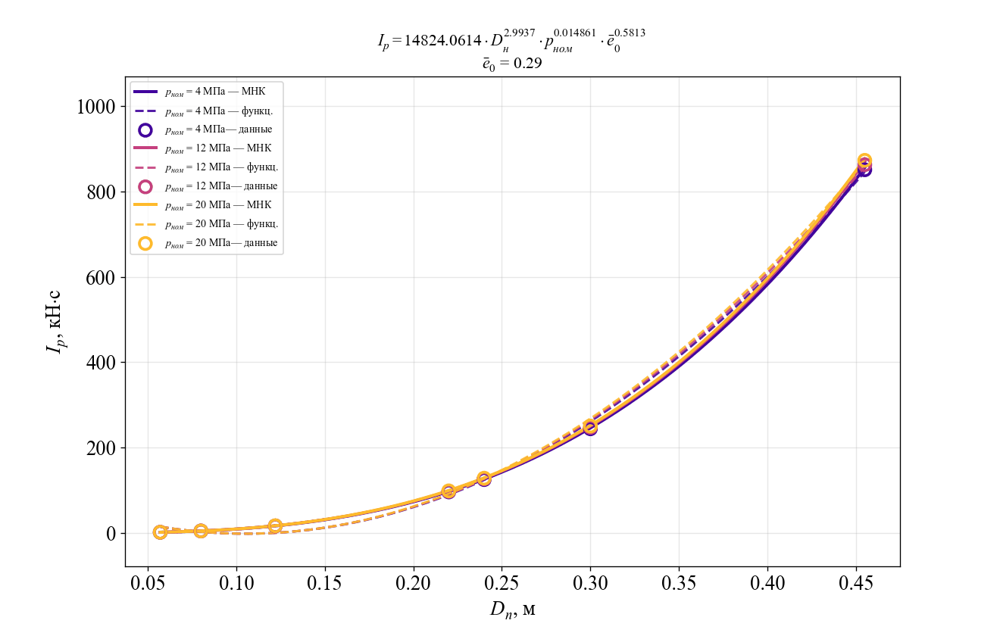
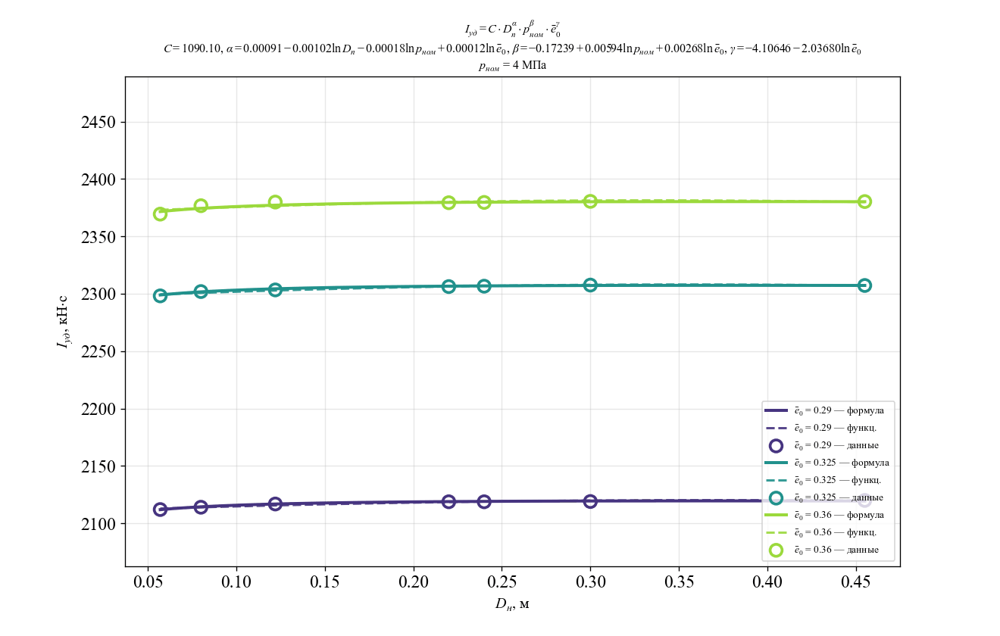
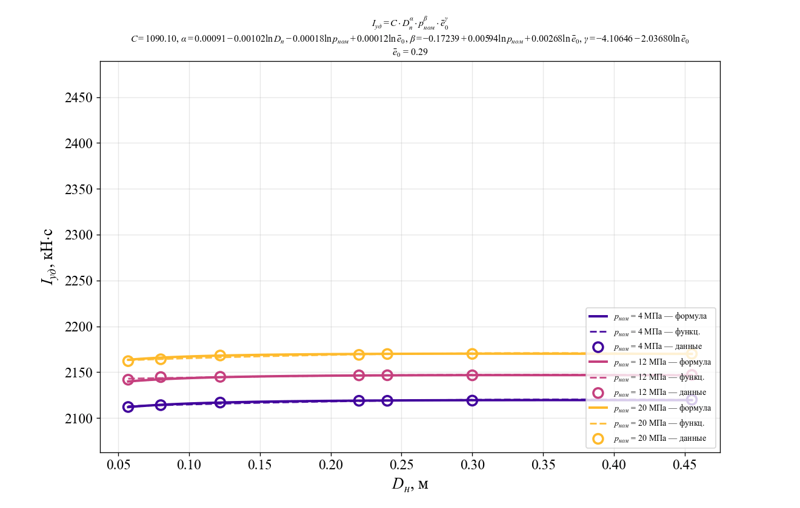
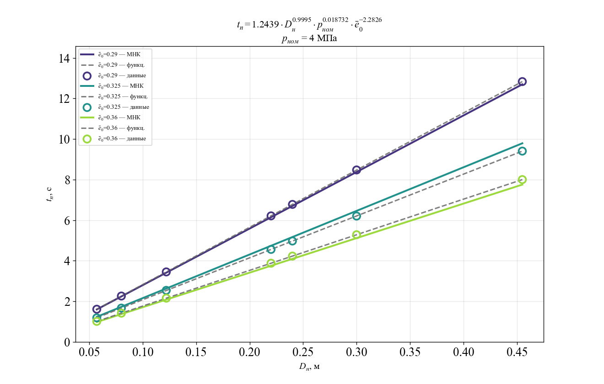
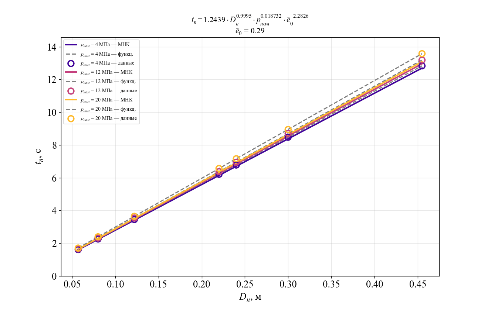

markdown

# 🚀 Оценка влияния форм заряда твердого ракетного топлива и сопла ракетного двигателя твердого топлива на внутрибаллистические характеристики ракетного двигателя твердого топлива

В данной работе исследуется влияние геометрии заряда твердого ракетного топлива (ТРТ) и сопла на внутрибаллистические характеристики ракетного двигателя твердого топлива (РДТТ), таких как полный и удельный импульс, время горения и максимальное давление, для ряда ракетных систем (С-5, С-8, С-13, С-24, «Ураган», «Смерч», Х-15).

## 📐 Математическая модель

### 1. Геометрия заряда ТРТ и сопла

- **Варьируемые параметры:** номинальное давление $p_{\text{ном}}$ и безразмерная толщина свода $\bar{e}_0$.
- **Форма заряда:** звездообразное сечение (7 лучей).
- **Условие отсутствия эрозионного горения:** $\kappa_0^{\text{доп}} = 85$, откуда определяется масса топлива $\omega_т$ для различных $\bar{e}_0$.
- **Выбор единой массы топлива:** $\omega_т = \min(\omega_{т_i})$ — минимальная масса для всех вариаций $\bar{e}_0$.
- **Формула Бори** — для определения диаметра критического сечения $D_{\text{кр}}$.
- **Ключевые параметры:** $D_{\text{кс}}$, $e_0$, $r$, $l_{\text{зар}}$, $D_{\text{кр}}$, $D_a$.

### 2. Воспламенительный состав

- **Состав:** MTV — 58% Mg, 38% C₂F₄, 4% Viton.
- **Модель горения:** двояковыпуклая таблетка.
- **Оптимизация:** масса $\omega_в$ и толщина свода $e_в$ воспламенителя по критерию минимизации отношения $p_{\max} / p_{\text{ном}}$ и времени воспламенения $t_в$.

### 3. Прямая задача внутренней баллистики

- Решается система дифференциальных уравнений для $p(t)$, $T(t)$, $W(t)$ и других параметров.
- Учитывается **эрозионное горение**, **теплообмен** и **изменение площади поверхности горения**.
- Интегрирование — **метод Рунге-Кутты 4-го порядка**.

---

## 📊 Ключевые результаты

На основе регрессионного анализа **63 численных экспериментов** получены следующие зависимости (R² > 0.99).

### 🔹 Полный импульс $I_p$, кН·с

$$
I_p = 14824{,}061425 \cdot D_{н}^{2{,}993671} \cdot p_{\text{ном}}^{0{,}0186084} \cdot \bar{e}_0^{0{,}581319}
$$

### 🔹 Удельный импульс $I_{уд}$, м/с

$$
I_{уд} = C \cdot D_{н}^{\alpha} \cdot p_{\text{ном}}^{\beta} \cdot \bar{e}_0^{\gamma}
$$

где

$$
C = 1090{,}1023
$$

$$
\alpha = 0{,}00091 - 0{,}001021 \ln D_{н} - 0{,}000182 \ln p_{\text{ном}} + 0{,}000117 \ln \bar{e}_0
$$

$$
\beta = -0{,}172394 + 0{,}005941 \ln p_{\text{ном}} + 0{,}002679 \ln \bar{e}_0
$$

$$
\gamma = -4{,}106459 - 2{,}036804 \ln \bar{e}_0
$$

### 🔹 Полное время горения заряда $t_{\text{п}}$, с

$$
t_{\text{п}} = 1{,}243895 \cdot D_{н}^{0{,}999458} \cdot p_{\text{ном}}^{-0{,}01873191} \cdot \bar{e}_0^{2{,}282552}
$$

> **Примечание:** в формуле для удельного импульса показатели $\alpha$, $\beta$, $\gamma$ не константы, а зависят от $D_{н}$, $p_{\text{ном}}$ и $\bar{e}_0$ (логарифмически), поэтому их нужно вычислять на каждом шаге расчёта.

| Обозначение | Наименование | Единица измерения |
|:---:|:---|:---:|
| $t_{\text{осн}}$ | Время горения основного заряда | с |
| $I_p$ | Полный импульс | кН·с |
| $I_{уд}$ | Удельный импульс | м/с |
| $D_{н}$ | Калибр двигателя | м |
| $p_{\text{ном}}$ | Номинальное давление в камере сгорания | Па |
| $\bar{e}_0$ | Безразмерная толщина свода заряда | — |

